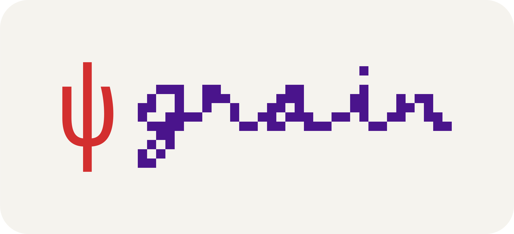

<p align="center">
  <picture>
    <source media="(prefers-color-scheme: dark)" srcset="assets/grain_logos/cavalhatriz/gen1_card_psi_cavalhatriz_duotone_on_purple.svg" />
    
  </picture>
</p>

<p align="center">
  <strong>A computer you can read all the way down -- from pure human intent to open RISC-V silicon.</strong>
</p>

<p align="center">
  <a href="modules/apps/bloom/art-of-programming/00-your-mac-your-keys-and-the-lantern-dragon.md">New to Coding? (Bloom 00..12)</a> -
  <a href="docs-geode/tutorials/the-first-hour.md">The First Hour</a> -
  <a href="docs-geode/README.md">Operator Geode</a> -
  <a href="languages/README.md">5 Languages</a> -
  <a href="modules/README.md">Modules</a> -
  <a href="libraries/README.md">Libraries &amp; Shastra</a> -
  <a href="blazepod/BOM_AND_ASSEMBLY.md">Blazepod BOM</a>
</p>

---

## Why Grain Exists

Modern software asks individuals, hospitals, farms, studios, and enterprises to build their lives atop tens of millions of lines of opaque dependencies where memory ceilings are unmeasured, versions drift, and nobody can prove what a machine will do under stress.

**Grain** takes the opposite road. Inspired by ecological agriculture ([*The Return That Feeds Everyone*](foundations/20260823-034321_the-return-that-feeds-everyone.md), rooted in Helen Atthowe's veganic, closed-loop biocyclic soil stewardship where a living field generates its own fertility without extractive waste) and high-assurance systems engineering ([`context/TAME_CORE.md`](context/TAME_CORE.md)), Grain builds a **complete, verifiable computing stack** small enough to audit end to end:

- **Approachable on Day One:** Written in clear, welcoming prose ([`docs-geode/`](docs-geode/README.md)) so a curious eighth-grader and a principal systems engineer can both build the compiler from source and run a hardware-verified proof inside one hour.
- **Enterprise-Grade Determinism:** Every loop, slice, network packet, and memory arena declares an explicit compile-time ceiling (**TAME Guidance**). Zero hidden heap churn, zero ambient authority, and zero semantic-versioning guesswork -- every module and release carries a monotonic **chronological version stamp (`YYYYMMDD.HHMMSS`)** ([`docs-geode/api/chronological-versioning.md`](docs-geode/api/chronological-versioning.md)).
- **Agent-Native by Construction:** Visual surfaces in **Brushstroke / Skate** and versioned histories in **Blaze / Flare** expose pure callable functions ([`docs-geode/architecture/realidream-agentic-weave.md`](docs-geode/architecture/realidream-agentic-weave.md)) so human builders and **Google Gemini (`gemini-4-carbon`)** + local **Flare** subagents collaborate over exact, deterministic state rather than brittle screen-scraping.

---

## Live Health & Myofascia Reading

Every claim at this front door is backed by executable **witnesses** in [`tools/`](tools/) and measured by [`modules/sundial/sundial.rye`](modules/sundial/sundial.rye). **Myofascia** measures the living connective tissue of the tree (how cleanly every link, bound, and module seam connects without rot), advancing `+0.001` with each completed orbit from our `56.500` baseline:

<!-- metrics:begin -- generated by tools/r/readme_metrics.rish; do not edit by hand -->

| Reading | Measured Now |
|---|---|
| **Myofascia** -- living connective integrity (`+0.001` / orbit) | **57.045** / 100.000 |
| **Glow rune digraphs** verified live in `languages/glow/front/rune_book.rye` | **48** |
| **Chronological spine** (`YYYYMMDD.HHMMSS`, zero semver) | **20261119.115928** |
| **Scattered archive closets** outside [`yonder/`](yonder/README.md) | **0** |

<!-- metrics:end -->

---

## Five Small Languages (`languages/`), One Shared Value Model

Instead of one sprawling language full of private macros, [`languages/`](languages/README.md) composes five focused languages that share **one static byte layout** ([*Growing a Language*](foundations/20260618-184912_growing-a-language.md)):

| Language | Path | Extension | Role in the Ecosystem |
|---|---|---|---|
| **Glow** | [`languages/glow/`](languages/glow/README.md) | `.glow` | **Pure Citizen Logic:** Two-character ASCII runes (`\|=`, `=_`, `=^`, `?:`, `/-`, `/+`) for total functions, wire validators, and replayable state folds -- lowering to native Rye and bare-metal **RISC-V**. |
| **Rye** | [`languages/rye/`](languages/rye/README.md) | `.rye` | **Bounded Systems Metal:** Explicit bit widths (`u32` memory, `u64` wire), static **Tally** memory gardens, SIMD/crypto, and zero-jitter audio/boot. |
| **Rishi** | [`languages/rishi/`](languages/rishi/README.md) | `.rish` | **Structured Shell & Witness Runner:** Typed process pipelines and positive + negative metal proofs. |
| **Brix** | [`languages/brix/`](languages/brix/README.md) | `.brix` | **Declarative Composition:** Flat key-value manifests and `infuse` overrides (`Glow = code, Brix = data`; [`.brix`](.brix)). |
| **Kyri** | [`languages/kyri/`](languages/kyri/README.md) | `.kyri` | **Immutable Boundary Records:** Human-legible, line-oriented receipts, profiles, and `scribe` validation. |

---

## Core Faculties (`modules/`) and Sovereign Hardware (`blazepod/`)

Every runtime faculty inside [`modules/`](modules/README.md) co-locates its pure citizen `.glow` gates/shapes (`glow/`) right beside its `< 300`-line `.rye` metal steward:

| Domain | Rooms | What Runs and Grows There |
|---|---|---|
| **Hardware & Memory** | [`blazepod/`](blazepod/README.md), [`terrarium/`](terrarium/), [`modules/aurora/`](modules/aurora/README.md), [`modules/tally/`](modules/tally/) | Bare-metal **RISC-V** boot, macOS/QEMU world under glass, **`4 GiB+` RAM-Only Grain (`tally-ram`)**, and **Von Neumann NVMe + Wi-Fi + Cellular Airlock (`tally-vn`)** |
| **Isolation & Custody** | [`modules/caravan/`](modules/caravan/), [`modules/pond/`](modules/pond/README.md), [`modules/crypto/`](modules/crypto/) | Fault-isolated capability supervision, auditable key retention/erasure (`caravan/custody/`), citizen sandboxes, and SHA3 / ChaCha20-Poly1305 / Ed25519 |
| **Storage, Wire & Market** | [`modules/blaze/`](modules/blaze/src/main.rye), [`modules/tablecloth/`](modules/tablecloth/README.md), [`modules/amphora/`](modules/amphora/README.md), [`modules/kumara/`](modules/kumara/README.md), [`modules/comlink/`](modules/comlink/README.md), [`modules/market/`](modules/market/README.md) | Content-addressed weaves, vector & named-bead search, sealed vessels, sovereign identity, encrypted P2P wire turns, and balanced double-entry Dimeroll accounting |
| **Surface, Studio, AI & Apps** | [`modules/brushstroke/`](modules/brushstroke/README.md), [`modules/resonance/`](modules/resonance/README.md), [`modules/flare/`](modules/flare/README.md), [`modules/apps/`](modules/apps/README.md) | Immediate-mode `FrameGrid` UI (`skate/` + `image/`), 48 kHz creative audio studio (`mikrophone/` + `composition/`), license-clean local AI, and citizen apps (`linengrow`, `bloom`, `mycelium`, `colloquium`) |
| **Truth, Plans & Vaults** | [`docs-geode/`](docs-geode/README.md), [`active-pulp/`](active-pulp/README.md), [`mitra-shed/`](mitra-shed/README.md), [`yonder/`](yonder/README.md) | Unified crystal documentation, prepend-to-front Pulp movement boards, Anuradha/Mitra *accrete-never-break* fossil prep (`shed-prep.md`), and the single bottom-sorted `yonder/` archive vault |

Brand marks -- featuring **Cavalhatriz** + **Noto Sans Mono** (alongside `Iosevka`, `JetBrains Mono`, and `Fira Code`) in our vegan **Oat / Material Purple / Material Red** palette -- live in [`assets/`](assets/README.md).

---

## Start in Five Minutes

```sh
git clone https://github.com/xykj61/202611-grain.git grain
cd grain
sh tools/f/fetch-toolchain.sh
cd languages/rye && ./bootstrap.sh && cd ../..
mkdir -p languages/rishi/bin && languages/rye/bin/rye build languages/rishi/src/main.rye -femit-bin=languages/rishi/bin/rishi
languages/rishi/bin/rishi run tools/b/bricks_exist_witness.rish
```

Follow the full guided walkthrough in **[The First Hour](docs-geode/tutorials/the-first-hour.md)**.

---

## Licensing & Clean-Room Gratitude

Grain's original code is dual-licensed under **[MIT](LICENSE-MIT)** and **[Apache-2.0](LICENSE-APACHE)**, with prose and brand assets under **[CC-BY-4.0](LICENSE-CC-BY)**. Every external lineage we study and thank -- TigerBeetle, Urbit, Zig, seL4 Microkit, Monocypher, s6, and more -- is honored whole and unmodified in [`gratitude/`](gratitude/README.md) while all Grain code is authored clean-room under our own names ([`context/SILO_TECHNIQUE.md`](context/SILO_TECHNIQUE.md)).

---

*May every claim here be one a machine can check on your own desk. May what we build renew the ground beneath it, and give back more clarity, safety, and joy than it took.*
